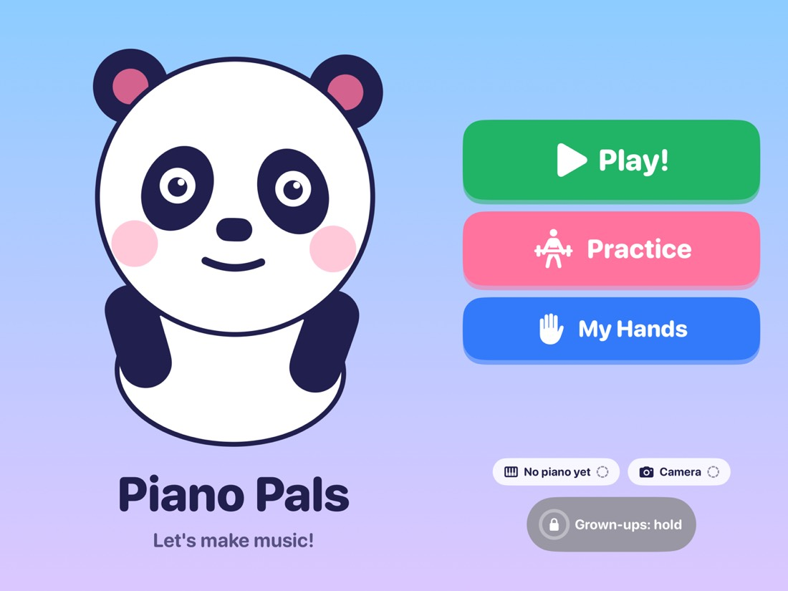
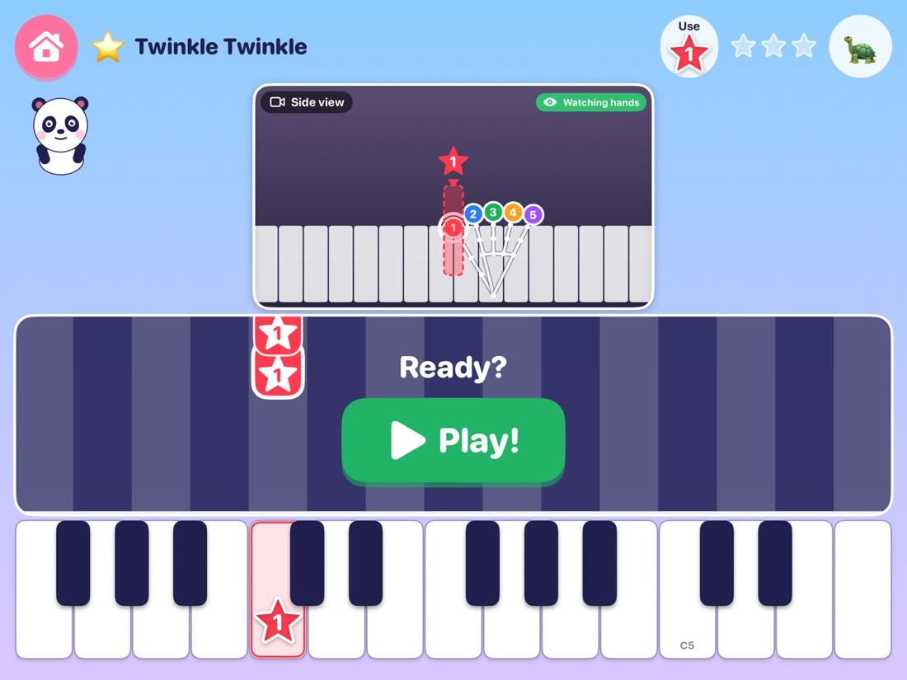
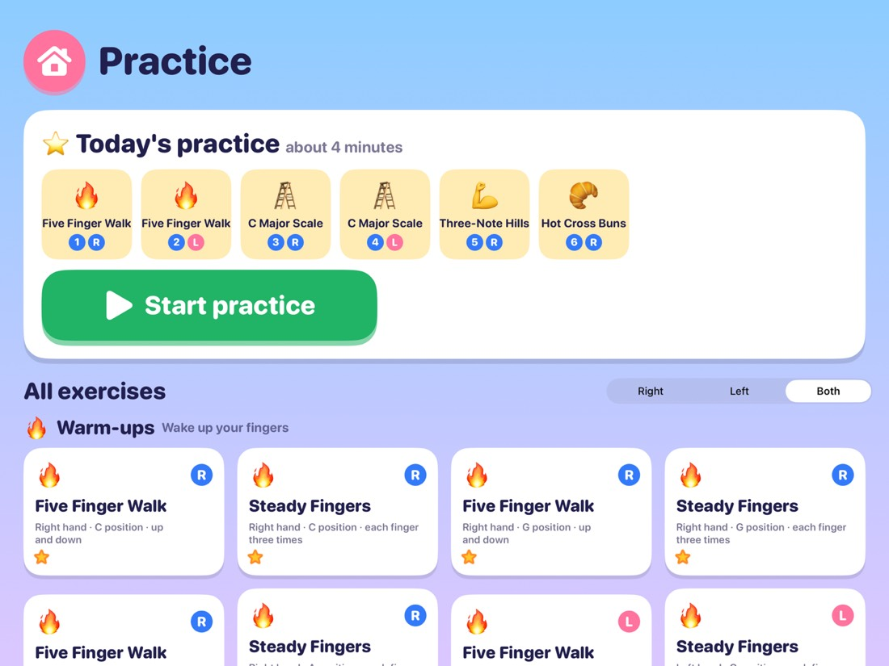

# Piano Pals

A free piano teacher for a 5-year-old that runs entirely on the iPad. A camera watches the child's hands on a real keyboard, a USB-C MIDI keyboard tells the app which key was pressed, and a friendly panda shows which finger to use, cheers when it goes well, and never says anything negative.

<p>
  
  
  
</p>

*Screenshots are from the iPad simulator with the built-in demo hands.*

## What it does

**For the child**
- A lesson screen with the camera view on top, falling notes in the middle and a big on-screen keyboard below.
- Every finger has a colour, a shape and a number (thumb = red star, index = blue circle, middle = green triangle, ring = orange diamond, pinky = purple heart).
- The camera sees which finger played which key. If it is the wrong finger, the lesson pauses, steps back 2 seconds and waits for the right one (after 3 tries in a row it moves on, so a child is never stuck; a Grown-ups switch turns this off).
- Feedback is always gentle: no red, no error sounds, no negative words (a test checks every phrase the coach can say).
- Two pacing modes: **wait for me** and **play along**, with a slow-speed button.
- A practice section with more than 40 beginner exercises (five-finger patterns, scales for each hand, finger drills) and a daily 12-minute practice block that adapts to the weakest finger.
- The keyboard window pans by whole octaves to follow the music, and never shows keys your keyboard does not have.

**For the grown-up** (behind a press-and-hold button)
- Add songs by typing a title, pasting a YouTube link (only the video title is read), typing notes (`C4 D4 E4:2`), importing a MIDI file, or playing or humming near the iPad.
- **Make a lesson from a recording:** pick an audio file and the notes are found on the iPad with the Basic Pitch model (right-hand melody plus left-hand bass).
- **Find a song online:** type a song, watch four steps run (your songs, the free library, Apple and MusicBrainz, open-licence MIDI sites), play Apple's 30-second sample to confirm it is the right song, and see what can really be done for it.
- Search free MIDI on Mutopia and Wikimedia Commons. Only public domain, CC0, CC BY and CC BY-SA files are ever offered.
- Per-session progress for parents and the choice of which camera does the tracking.

**Cameras**
- The iPad's own camera, or an iPhone propped above the keys as an overhead camera over an encrypted local link (iPadOS does not offer an iPhone to third-party apps as a Continuity Camera, so the app does its own pairing).
- Mac Catalyst build for a Mac.

## Requirements

| | |
|---|---|
| Xcode | Built with Xcode 27 (Swift 5 language mode). Targets iOS 17 / macOS 14 (Catalyst). |
| iPad | Main target (developed on an iPad Pro 13-inch M4). iPhone and Mac run it too. |
| Keyboard | Any USB-C MIDI keyboard. Tuned for a 61-key board (Impact LX61+, C2 to C7); other sizes are in Grown-ups > Piano. |
| Camera | The iPad's camera, or an iPhone running the same app in camera mode. |
| Signing | The project is set to team `TV279PMMV8` and bundle ID `com.example.PianoPals`. Change both to your own to run on a device. |

## Quick start

```bash
git clone git@github.com:atsaini-lrnr/Piano_pals.git
cd Piano_pals
open PianoPals.xcodeproj
```

1. Pick the **PianoPals** scheme and an iPad simulator, then Run. No camera or keyboard is needed in the simulator: turn on **demo hands** in Grown-ups and tap the on-screen keys.
2. **On a real iPad:** set your team in *Signing & Capabilities*, plug in your USB-C MIDI keyboard, press Run.
3. **Grown-ups corner:** press and hold the grey *Grown-ups* button on the home screen for about a second.
4. **My Hands** on the home screen calibrates the camera to your keyboard (the child places each hand on a big hand-print).

### Use an iPhone as the overhead camera

1. Install the same app on the iPhone and open it. It turns into a camera automatically and shows an 8-digit pairing code.
2. On the iPad open *Grown-ups > Choose cameras*, pick the iPhone and type the code (needed once).
3. Prop the iPhone above the keys, pointing down. Both devices need the same Wi-Fi or Bluetooth.

To build and install on every connected, unlocked device in one go:

```bash
tools/install_on_devices.sh
```

## How it works

Everything runs on the device. There is no cloud model.

| Folder (`PianoPals/`) | What is in it |
|---|---|
| `App` | App model, settings, demo hands, screen routing |
| `Camera` | One capture pipeline per camera, device discovery, preview encoding |
| `Vision` | Hand pose (Apple Vision), smoothing (One-Euro filter), finger-to-key attribution against the keyboard region |
| `MIDI` | CoreMIDI input (MIDI 1.0 and 2.0 UMP), on the same clock as the camera frames |
| `Lesson` | Lesson engine, fingering (Viterbi), song library and matcher, exercises and daily planner, web and catalogue search |
| `Coach` | Mistake analysis, rate-limited gentle tips, session summaries |
| `Audio` | Tone synthesizer, narrator, pitch detection (YIN) for Listen mode |
| `Transcribe` | Audio file to notes: Basic Pitch Core ML model, window stitching, note decoding |
| `Companion` | iPhone camera mode: Bonjour discovery, TLS with a pre-shared key from the pairing code, clock sync |
| `Calibration` | Hand-print calibration of the keyboard region |
| `Views` | SwiftUI screens and overlays |
| `Resources` | Song index (public-domain melodies, each with a licence field) and the Basic Pitch model |

## Privacy

- Camera pictures, hand data, microphone sound and MIDI never leave the device. Audio from Listen mode is analysed in memory and not stored. Recordings you import are not kept.
- The iPhone camera link is encrypted with a key derived from the pairing code.
- The only network requests are text lookups, and the screen says which sites get the words:
  YouTube oEmbed (title of a pasted link), `mutopiaproject.org` and `commons.wikimedia.org` (free MIDI search),
  and Apple's iTunes Search and MusicBrainz (the "Find a song online" list).
- The app does not download audio or video from YouTube or any streaming service.

## Tests

```bash
xcodebuild test -project PianoPals.xcodeproj -scheme PianoPals \
  -destination 'platform=iOS Simulator,name=iPad Pro 13-inch (M4)' \
  -only-testing:PianoPalsTests
```

- 285 unit tests: geometry, MIDI parsing, fingering, song matching, the coach and its banned-word check, the lesson engine and replay rule, encrypted transport over loopback, Basic Pitch decoding (including real model runs on synthetic piano tones), web-search parsing, and more.
- UI tests (`PianoPalsUITests`) cover the lesson layout, the practice block, the Grown-ups flows and the song search. The layout test forces landscape.
- `docs/TEST_PLAN.md` lists what still needs a real device, a real piano and a child.

Useful launch arguments for development: `-debugScreen lesson|practice`, `-debugSong "twinkle"`, `-demoHands YES`, `-debugGrownUps YES`.

## Project documents

Start with **[docs/FR_TRACKER.md](docs/FR_TRACKER.md)**, the single index of what is built, what is verified and what is still open.

| Document | |
|---|---|
| [PRD.md](docs/PRD.md) | Original product requirements and success metrics |
| [PRD_AI_COACH.md](docs/PRD_AI_COACH.md) | Coach, song index, listen mode, iPhone camera mode |
| [PRD_V3_PRACTICE_AND_TRANSCRIBE.md](docs/PRD_V3_PRACTICE_AND_TRANSCRIBE.md) | Layout, exercises, web search, audio to notes |
| [PRD_V4_SEARCH_AND_CONVERT.md](docs/PRD_V4_SEARCH_AND_CONVERT.md) | What AI-MIDI and YouTube-to-MIDI tools take, what is free, and the song-search plan |
| [ARD.md](docs/ARD.md) | Architecture decisions |
| [TEST_PLAN.md](docs/TEST_PLAN.md) | Test plan |

`tools/build_song_index.py` extends the bundled song index from a folder of MIDI files. It refuses any row without an acceptable licence.

## Status and known limits

- Verified in the simulator and in unit tests. Parts that need real hardware (camera accuracy on a real hand, latency, a real piano recording for the transcription accuracy check) are marked in the tracker.
- Hand tracking can misread a hand that appears sideways in the picture. Turn the picture with the rotate button so the keys run left to right.
- Modern copyrighted songs have no free legal MIDI online. The app offers a recording you own, playing or humming it, or a clearly labelled practice tune.

## Credits and licences

- **Basic Pitch** (Spotify) is bundled unchanged under the Apache License 2.0; see `PianoPals/Resources/BasicPitch/`.
- Songs in the index are public-domain melodies, each with its licence recorded. MIDI found online is filtered to public domain, CC0, CC BY and CC BY-SA.
- The app's own code has **no licence file yet**, so all rights are reserved until the owner adds one.
